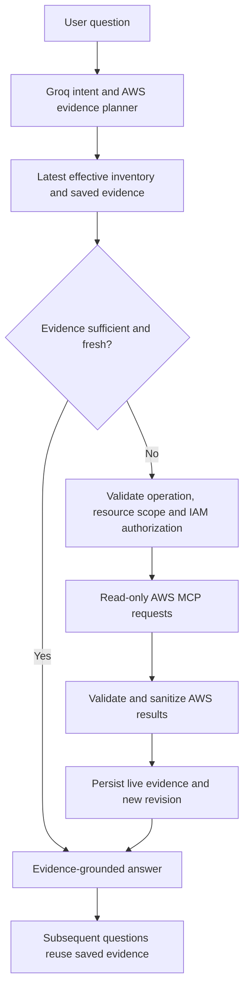

# Multicloud-MCP

### Dynamic AWS Inventory, MCP-Powered Investigation & Evidence-Grounded AI Chat

Multicloud-MCP is an AWS-focused cloud discovery and investigation platform that connects a **dynamic resource inventory** with **Groq-powered natural-language questions** and **read-only AWS Model Context Protocol (MCP)** operations.

The application is designed to answer questions using the latest saved inventory and previously verified evidence. When additional or fresher information is required, the AI query planner can propose targeted AWS reads. Successful results are retained as versioned evidence for subsequent questions—**without restarting a full-account scan for every query**.

> **Project status:** Active development / prototype. AWS is the only implemented cloud-provider target. Local/offline tests have been exercised during development, but end-to-end behavior must be validated against an authorized AWS test account before production use. Do not treat the chat as a certified compliance assessment.

## Table of Contents

- [Key Features](#key-features)
- [How It Works](#how-it-works)
- [Architecture](#architecture)
- [Technology Stack](#technology-stack)
- [Getting Started](#getting-started)
- [Using the Application](#using-the-application)
- [Inventory and Evidence Model](#inventory-and-evidence-model)
- [Security Principles](#security-principles)
- [Current Limitations](#current-limitations)
- [Development Roadmap](#development-roadmap)

## Key Features

| Capability                         | Description                                                                                                                                                          |
| ---------------------------------- | -------------------------------------------------------------------------------------------------------------------------------------------------------------------- |
| **Dynamic AWS discovery**          | Collect account identity, Regions, Availability Zones and indexed resource/service inventory from authorized AWS sources. No fixed customer service list is assumed. |
| **Inventory-first AI**             | Use the latest effective inventory when answering questions about discovered services and resources.                                                                 |
| **Targeted live investigation**    | Route questions requiring missing or current data to validated, read-only AWS MCP operations instead of automatically rerunning the whole scan.                      |
| **Multi-operation query planning** | Groq may plan multiple bounded AWS read operations for a question; the backend validates execution permissions and scope.                                            |
| **Persisted AWS evidence**         | Store successful live results, provenance and timestamps for later reuse. Attach resource-level fields only when identity can be established reliably.               |
| **Scan and change history**        | Preserve original automatic scans and maintain an append-only history of inventory updates and live evidence.                                                        |
| **Service management**             | Add, exclude and restore services **inside the application's effective inventory**. These actions do not create or delete AWS infrastructure.                        |
| **Contextual AI chat**             | Use general-account, service-specific and resource-specific conversations.                                                                                           |
| **AWS Regions view**               | Display Regions and observed resource usage in a read-only interface. An undetected Region is not necessarily empty.                                                 |
| **Billing visibility control**     | Keep billing details collapsed in the UI until opened. The scanner may still collect cost evidence during Auto Scan.                                                 |
| **Workspace isolation**            | Associate connections, scans, evidence and chats with the appropriate workspace/account.                                                                             |

**Classification policy:** Multicloud-MCP does **not** assign Primary, Secondary or Tertiary labels to AWS services.

## How It Works



The automatic discovery workflow and the chat workflow are intentionally separate:

- **Auto Scan:** Discovers and saves a baseline snapshot of the AWS account.
- **User Update:** Adds, excludes or restores a service in the effective inventory; the original AWS snapshot remains unchanged.
- **AI Investigation:** Uses saved evidence first. When the planner identifies required information that is not available or fresh enough, a targeted MCP read may be executed and saved.

A missing value **does not automatically guarantee** an AWS call. The planner must identify an appropriate operation, the backend must allow it, the connection must be authorized, and the provider must return usable results. When that is not possible, the application must report the evidence gap rather than invent an answer.

## Architecture

```text
                     Streamlit Web Dashboard
                              |
                         FastAPI Backend
                              |
           +------------------+-------------------+
           |                  |                   |
      AWS Discovery      Inventory/History     Groq Query Router
           |                  |                   |
       AWS MCP/API      SQLite + SQLAlchemy    Evidence Resolver
           |                  |                   |
       AWS Account      Effective Revisions     Read-only AWS MCP
                              |                   |
                              +------ Evidence ---+
                                         |
                                 Grounded AI Answer
```

### Important modules

```text
app/
  ai/                 Groq intent planning, response generation and chat routing
  api/                Authentication, workspaces, AWS connections, scans and chats
  auth/               User authentication and authorization
  db/                 SQLAlchemy models and async sessions
  providers/aws/      AWS discovery, credentials, MCP and query execution
  services/           Inventory revisions and persisted AWS evidence
ui/
  app.py              Streamlit dashboard
alembic/
  versions/           Database migrations
tests/                  Offline and regression tests
```

The generic enrichment pipeline is **service-independent at the orchestration level**, but AWS APIs differ in their response structure. Unrecognized or ambiguously scoped responses can be stored as query evidence without being falsely mapped to a resource.

## Technology Stack

| Layer              | Technology                       |
| ------------------ | -------------------------------- |
| Language           | Python 3.12+                     |
| Backend API        | FastAPI, Uvicorn                 |
| Web UI             | Streamlit                        |
| AI/NLP             | Groq                             |
| Cloud integration  | AWS APIs through MCP             |
| ORM/database       | SQLAlchemy, SQLite (development) |
| Migrations         | Alembic                          |
| Validation         | Pydantic                         |
| Package management | `uv`                             |

## Getting Started

### Prerequisites

- Python 3.12 or later
- `uv` installed
- A Groq API key
- An AWS account and appropriately scoped **read-only permissions**
- A working AWS MCP connection supported by the repository configuration

### 1. Clone the repository

```bash
git clone https://github.com/<your-github-username>/<repository-name>.git
cd <repository-name>
```

Replace the placeholder organization/repository name with your actual GitHub URL.

### 2. Install dependencies

```bash
uv sync
```

### 3. Configure environment variables

Create a local `.env` file at the project root. **Never commit it.**

```dotenv
APP_ENV=development
JWT_SECRET_KEY=replace-with-a-long-random-secret
GROQ_API_KEY=replace-with-your-groq-api-key
GROQ_INTENT_MODEL=openai/gpt-oss-20b
DATABASE_URL=sqlite+aiosqlite:///./data/aws_auditor.db
AWS_MCP_ENDPOINT=https://aws-mcp.us-east-1.api.aws/mcp
AWS_MCP_ENDPOINT_REGION=us-east-1
MCP_READ_ONLY=true
```

The AWS MCP endpoint above is an example of the current project's configuration, not a guarantee that your account has access to that endpoint. Configure authorization and the relevant IAM trust relationship according to your environment.

For long-running connections, prefer **cross-account IAM AssumeRole with a unique External ID** and temporary STS credentials. Do not save customer AWS access keys or session secrets in the application database or Git repository.

### 4. Apply database migrations

```bash
uv run alembic current
uv run alembic upgrade head
```

For an existing installation, take a secure database backup before running migrations. Use the migration history that matches the version of the code being deployed.

### 5. Start the API

```bash
uv run uvicorn app.main:app --reload
```

API: `http://127.0.0.1:8000`  
Interactive API documentation: `http://127.0.0.1:8000/docs`

### 6. Start the Streamlit dashboard

In a second terminal:

```bash
uv run streamlit run ui/app.py
```

The dashboard normally opens on `http://localhost:8501`.

## Using the Application

1. **Register or sign in** and select your workspace.
2. **Connect an AWS account** using a permitted authentication method.
3. **Run Auto Scan** to discover the initial service/resource inventory.
4. **Explore AWS Services, Regions and Resources** using the accordion dashboard.
5. **Add, exclude or restore a service** in the application inventory when needed. Regions and resource entries remain read-only in the UI.
6. **Open AI Chat** for the full account or select a specific service/resource for a contextual conversation.
7. **Review History** to see saved scan and update revisions. Expand Billing only when you want to inspect saved cost information.

### Example questions

```text
Show all AWS services discovered in this account.
Which Regions currently have discovered resources?
How many RDS instances are recorded in my latest inventory?
What is the configuration of this selected EC2 instance?
Is encryption configured on this selected database?
Which saved AWS evidence supports your answer?
When was this resource configuration last verified?
```

Some questions require live AWS evidence, appropriate service permissions, or additional security checks. A **resource being discovered does not prove it is secure**.

## Inventory and Evidence Model

Multicloud-MCP separates three concepts:

- **Automatic scan:** The baseline snapshot of AWS-observed inventory.
- **Effective inventory:** The latest saved view with user service changes and validated enrichment.
- **Live evidence:** Read-only MCP responses associated with the source account, operation, resource scope, verification time and inventory revision.

This separation helps prevent manually entered services from being presented as AWS-verified resources and avoids rewriting historical scans when new evidence arrives.

Saved evidence may become stale. Recent matching live results may be reused for a limited period (the Phase 3 development implementation uses a **15-minute window**); explicitly current-state questions may require a fresh read.

## Security Principles

- **Read-only by design:** Block mutating operations in the application and enforce least-privilege IAM permissions.
- **Temporary credentials:** Prefer AssumeRole/STS. Never commit or persist customer secrets as database inventory.
- **Tenant separation:** Scope credentials, connections, inventory, chat sessions and evidence to the appropriate workspace/account.
- **Evidence provenance:** Record where data came from and when it was verified.
- **Partial results:** Distinguish successful verification from access denied, missing coverage, incomplete pagination and failed calls.
- **No unsupported compliance claims:** AI responses are investigation aids, not substitutes for comprehensive, independently validated security assessments.
- **Protect repository contents:** Exclude `.env`, `data/*.db`, backups, local tokens, private keys, generated credential files and sensitive audit exports.

## Current Limitations

This project is under active development. Important known boundaries include:

- AWS is the current cloud provider; Azure and Google Cloud are **future integrations**, not implemented capabilities.
- Dynamic discovery may be incomplete when resource indexing, recording, permissions or regional coverage is limited.
- Generic AWS response normalization attaches fields to resources only when a reliable identity match is available; it cannot safely interpret every possible AWS response shape.
- Full compliance coverage, comprehensive service security rules and universal risk scoring are not provided automatically.
- Some parallel updates and multi-worker workflows may require stronger database concurrency controls before production deployment.
- Billing is hidden until opened in the UI, but collection may happen as part of Auto Scan.
- End-to-end AWS account, MCP and Groq testing is required for production deployment.

## Development Roadmap

- [x] AWS discovery and saved inventory snapshots
- [x] Service-level Add/Exclude/Restore in the effective inventory
- [x] Versioned scan, user-edit and live-evidence history
- [x] Contextual account/service/resource chat
- [x] Database-first query routing with targeted AWS MCP fallback
- [x] Generic read-only AWS operation planning and evidence persistence (development implementation)
- [ ] Evidence completeness checks that independently validate missing required fields
- [ ] Expand and verify resource identity mapping and regional discovery coverage
- [ ] Robust per-account concurrent write handling and production test suite
- [ ] Formal compliance-control mappings and coverage reporting
- [ ] Additional cloud providers (future)

## Contributing and License

For internal or restricted projects, establish contribution policies, branch protection and a security disclosure process before opening the repository to external contributors.

**License:** No license is asserted by this README. Add a `LICENSE` file only after the repository owner selects the intended licensing terms.

---

**Multicloud-MCP** — Dynamic AWS discovery, evidence-backed answers, and targeted MCP investigation.
